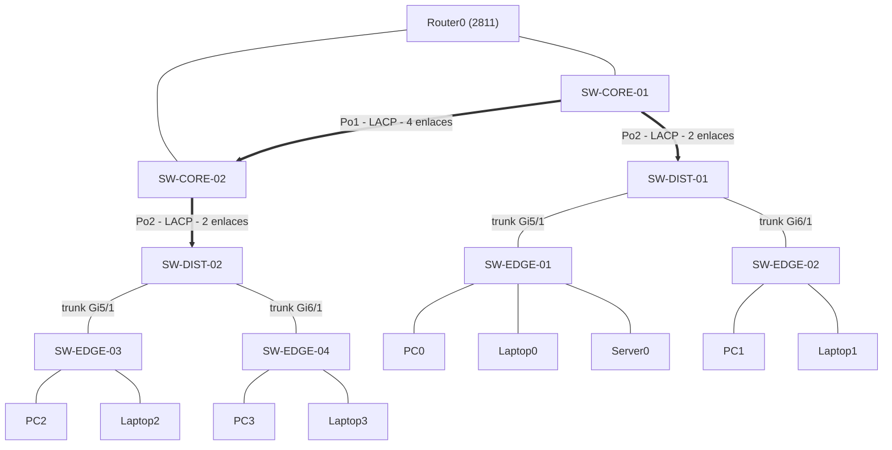

# Atividade 08 – Agregação de Links (EtherChannel / LACP) e Trunk

**Disciplina:** Comutação de Redes Locais  
**Curso:** Tecnologia em Redes de Computadores – IFRO Campus Porto Velho Zona Norte  
**Aluno:** Gabriel Mota Barroso  
**Ferramenta:** Cisco Packet Tracer 9.0.1.0858  
**Equipamentos:** Router0 (2811); SW-CORE-01 e SW-CORE-02; SW-DIST-01 e SW-DIST-02 (Switch-PT-Empty); SW-EDGE-01 a SW-EDGE-04 (2960-24TT)

---

## 1. Objetivo

Configurar canais de agregação de links (EtherChannel com LACP) entre os switches do ambiente hierárquico: quatro enlaces agregados entre os dois switches de núcleo e dois enlaces agregados entre cada switch de distribuição e o seu núcleo. As interfaces lógicas resultantes (Port-channels) operam como trunk 802.1Q e mantêm as VLANs 10 (Alunos) e 20 (Visitantes) das atividades anteriores.

## 2. Fundamentação

### 2.1 Agregação de links

A agregação junta várias interfaces físicas em um único enlace lógico. Na Cisco, o recurso se chama **EtherChannel** e a interface lógica é o **Port-channel**. Principais efeitos:

- **Largura de banda:** a capacidade nominal do canal é a soma dos membros.
- **Redundância:** se um membro falha, o canal continua com os demais.
- **Spanning Tree:** o STP enxerga o canal como um único enlace e deixa de bloquear os cabos paralelos.
- **Balanceamento:** os quadros são distribuídos entre os membros por um cálculo (hash) sobre endereços do quadro. Cada fluxo usa um único membro.

### 2.2 Protocolos de negociação

| Protocolo | Origem | Modos | Observação |
|---|---|---|---|
| PAgP | Cisco (proprietário) | `desirable` / `auto` | Só entre equipamentos Cisco |
| LACP | IEEE 802.3ad (hoje 802.1AX) | `active` / `passive` | Padrão aberto |
| Estático | – | `on` | Sem negociação; os dois lados em `on` |

Com LACP, o canal se forma com `active`+`active` ou `active`+`passive`. Dois lados `passive` não formam o canal.

### 2.3 Requisitos dos membros

Todas as interfaces de um mesmo canal precisam ter a mesma velocidade, o mesmo duplex, o modo trunk, a mesma VLAN nativa e a mesma lista de VLANs permitidas. Uma interface diferente é suspensa do canal.

### 2.4 Escolha desta implementação

Foi usado **LACP em modo `active` nos dois lados** de todos os canais.

## 3. Diagrama da topologia

<!-- Ativar depois de enviar a captura da topologia:

-->



## 4. Documentação técnica

### 4.1 VLANs e endereçamento

| ID | Nome | Dispositivos | IPs (máscara 255.255.255.0) |
|---|---|---|---|
| 10 | Alunos | PC0, PC1, PC2, PC3 | 192.168.10.10 a 192.168.10.13 |
| 20 | Visitantes | Laptop0, Laptop1, Laptop2, Laptop3 | 192.168.10.20 a 192.168.10.23 |
| 1 | default | Server0 | 192.168.10.100 |

O Default Gateway está em branco, pois o roteamento entre VLANs não faz parte desta atividade. Os endereços foram preservados das atividades anteriores.

### 4.2 Canais de agregação (Port-channels)

| Canal | Switch A | Membros em A | Switch B | Membros em B | Protocolo / modo | Capacidade nominal | Trunk |
|---|---|---|---|---|---|---|---|
| Po1 | SW-CORE-01 | Gi5/1, Gi6/1, Gi7/1, Gi8/1 | SW-CORE-02 | Gi5/1, Gi6/1, Gi7/1, Gi8/1 | LACP active / active | 4 × 1 Gbps | 802.1Q, nativa 1, VLANs 10,20 |
| Po2 | SW-CORE-01 | Gi1/1, Gi2/1 | SW-DIST-01 | Gi1/1, Gi2/1 | LACP active / active | 2 × 1 Gbps | 802.1Q, nativa 1, VLANs 10,20 |
| Po2 | SW-CORE-02 | Gi1/1, Gi2/1 | SW-DIST-02 | Gi1/1, Gi2/1 | LACP active / active | 2 × 1 Gbps | 802.1Q, nativa 1, VLANs 10,20 |

O número do grupo tem significado local em cada switch. Por isso o Po2 aparece em dois canais diferentes, cada um com extremidades compatíveis entre si.

### 4.3 Mapeamento de interfaces

#### Membros dos canais

| Switch | Interface física | Interface lógica | Conectada a |
|---|---|---|---|
| SW-CORE-01 | GigabitEthernet5/1 | Port-channel1 | SW-CORE-02 (Gi7/1) |
| SW-CORE-01 | GigabitEthernet6/1 | Port-channel1 | SW-CORE-02 (Gi6/1) |
| SW-CORE-01 | GigabitEthernet7/1 | Port-channel1 | SW-CORE-02 (Gi8/1) |
| SW-CORE-01 | GigabitEthernet8/1 | Port-channel1 | SW-CORE-02 (Gi5/1) |
| SW-CORE-01 | GigabitEthernet1/1 | Port-channel2 | SW-DIST-01 (Gi1/1) |
| SW-CORE-01 | GigabitEthernet2/1 | Port-channel2 | SW-DIST-01 (Gi2/1) |
| SW-CORE-02 | GigabitEthernet5/1 | Port-channel1 | SW-CORE-01 (Gi8/1) |
| SW-CORE-02 | GigabitEthernet6/1 | Port-channel1 | SW-CORE-01 (Gi6/1) |
| SW-CORE-02 | GigabitEthernet7/1 | Port-channel1 | SW-CORE-01 (Gi5/1) |
| SW-CORE-02 | GigabitEthernet8/1 | Port-channel1 | SW-CORE-01 (Gi7/1) |
| SW-CORE-02 | GigabitEthernet1/1 | Port-channel2 | SW-DIST-02 (Gi1/1) |
| SW-CORE-02 | GigabitEthernet2/1 | Port-channel2 | SW-DIST-02 (Gi2/1) |
| SW-DIST-01 | GigabitEthernet1/1 | Port-channel2 | SW-CORE-01 (Gi1/1) |
| SW-DIST-01 | GigabitEthernet2/1 | Port-channel2 | SW-CORE-01 (Gi2/1) |
| SW-DIST-02 | GigabitEthernet1/1 | Port-channel2 | SW-CORE-02 (Gi1/1) |
| SW-DIST-02 | GigabitEthernet2/1 | Port-channel2 | SW-CORE-02 (Gi2/1) |

#### Trunks individuais (Atividade 07, sem alteração)

| Switch | Interface | Conectada a | Modo |
|---|---|---|---|
| SW-DIST-01 | GigabitEthernet5/1 | SW-EDGE-01 (Gi0/1) | trunk, VLANs 10,20 |
| SW-DIST-01 | GigabitEthernet6/1 | SW-EDGE-02 (Gi0/1) | trunk, VLANs 10,20 |
| SW-DIST-02 | GigabitEthernet5/1 | SW-EDGE-03 (Gi0/1) | trunk, VLANs 10,20 |
| SW-DIST-02 | GigabitEthernet6/1 | SW-EDGE-04 (Gi0/1) | trunk, VLANs 10,20 |
| SW-EDGE-01 a SW-EDGE-04 | GigabitEthernet0/1 | SW-DIST (Gi5/1 ou Gi6/1) | trunk, VLANs 10,20 |

Esses quatro enlaces Distribuição–Acesso têm cabo único e, por isso, não participam de EtherChannel. É a explicação para as interfaces Gi5/1 e Gi6/1 dos switches de distribuição aparecerem como trunks individuais no `show interfaces trunk`, fora do Po2.

#### Enlaces fora do escopo

- Router0 ↔ SW-CORE-01 (Fa9/1) e Router0 ↔ SW-CORE-02 (Fa9/1): sem alteração.

### 4.4 Portas de acesso (Atividade 06, sem alteração)

| Switch | Interface | Dispositivo | IP | VLAN |
|---|---|---|---|---|
| SW-EDGE-01 | FastEthernet0/1 | PC0 | 192.168.10.10 | 10 – Alunos |
| SW-EDGE-01 | FastEthernet0/2 | Laptop0 | 192.168.10.20 | 20 – Visitantes |
| SW-EDGE-01 | GigabitEthernet0/2 | Server0 | 192.168.10.100 | 1 – default |
| SW-EDGE-02 | FastEthernet0/1 | PC1 | 192.168.10.11 | 10 – Alunos |
| SW-EDGE-02 | FastEthernet0/2 | Laptop1 | 192.168.10.21 | 20 – Visitantes |
| SW-EDGE-03 | FastEthernet0/1 | PC2 | 192.168.10.12 | 10 – Alunos |
| SW-EDGE-03 | FastEthernet0/2 | Laptop2 | 192.168.10.22 | 20 – Visitantes |
| SW-EDGE-04 | FastEthernet0/1 | PC3 | 192.168.10.13 | 10 – Alunos |
| SW-EDGE-04 | FastEthernet0/2 | Laptop3 | 192.168.10.23 | 20 – Visitantes |

## 5. Comandos Cisco IOS

Sequência equivalente à configuração salva no arquivo `.pkt`. Ordem: SW-CORE-01 → SW-CORE-02 → SW-DIST-01 → SW-DIST-02. Os switches de acesso não foram alterados nesta atividade.

### 5.1 Explicação dos comandos

| Comando | Modo | Função |
|---|---|---|
| `enable` | `Switch>` | Entra no modo privilegiado |
| `configure terminal` | `Switch#` | Entra no modo de configuração global |
| `interface GigabitEthernetX/Y` | `Switch(config)#` | Seleciona a interface física |
| `switchport mode trunk` | `Switch(config-if)#` | Coloca a interface em modo trunk |
| `switchport trunk allowed vlan LISTA` | `Switch(config-if)#` | Define as VLANs permitidas |
| `channel-group N mode active` | `Switch(config-if)#` | Inclui a interface no canal N com LACP ativo e cria o Port-channel N |
| `interface Port-channel N` | `Switch(config)#` | Seleciona a interface lógica do canal |
| `end` | qualquer modo de configuração | Volta ao modo privilegiado |
| `copy running-config startup-config` | `Switch#` | Salva a configuração na NVRAM |
| `show etherchannel summary` | `Switch#` | Resumo dos canais, protocolo e estado dos membros |
| `show interfaces trunk` | `Switch#` | Interfaces trunk e VLANs permitidas |

### 5.2 SW-CORE-01

```
enable
configure terminal
interface GigabitEthernet5/1
 switchport mode trunk
 switchport trunk allowed vlan 10,20
 channel-group 1 mode active
 exit
interface GigabitEthernet6/1
 switchport mode trunk
 switchport trunk allowed vlan 10,20
 channel-group 1 mode active
 exit
interface GigabitEthernet7/1
 switchport mode trunk
 switchport trunk allowed vlan 10,20
 channel-group 1 mode active
 exit
interface GigabitEthernet8/1
 switchport mode trunk
 switchport trunk allowed vlan 10,20
 channel-group 1 mode active
 exit
interface GigabitEthernet1/1
 switchport mode trunk
 switchport trunk allowed vlan 10,20
 channel-group 2 mode active
 exit
interface GigabitEthernet2/1
 switchport mode trunk
 switchport trunk allowed vlan 10,20
 channel-group 2 mode active
 exit
interface Port-channel1
 switchport mode trunk
 switchport trunk allowed vlan 10,20
 exit
interface Port-channel2
 switchport mode trunk
 switchport trunk allowed vlan 10,20
 exit
end
copy running-config startup-config
show etherchannel summary
```

### 5.3 SW-CORE-02

Mesmo bloco do SW-CORE-01: Gi5/1 a Gi8/1 no grupo 1, Gi1/1 e Gi2/1 no grupo 2, todos com `channel-group N mode active`, e as interfaces Port-channel1 e Port-channel2 em trunk com `allowed vlan 10,20`.

### 5.4 SW-DIST-01 e SW-DIST-02

```
enable
configure terminal
interface GigabitEthernet1/1
 switchport mode trunk
 switchport trunk allowed vlan 10,20
 channel-group 2 mode active
 exit
interface GigabitEthernet2/1
 switchport mode trunk
 switchport trunk allowed vlan 10,20
 channel-group 2 mode active
 exit
interface Port-channel2
 switchport mode trunk
 switchport trunk allowed vlan 10,20
 exit
end
copy running-config startup-config
show etherchannel summary
```

## 6. Validação

Comandos de verificação usados em cada switch de núcleo e distribuição:

```
show etherchannel summary
show interfaces trunk
```

### 6.1 Resultado do `show etherchannel summary`

| Switch | Grupo | Estado | Protocolo | Membros agregados |
|---|---|---|---|---|
| SW-CORE-01 | Po1 | SU | LACP | Gi5/1, Gi6/1, Gi7/1, Gi8/1: todos (P) |
| SW-CORE-01 | Po2 | SU | LACP | Gi1/1, Gi2/1: ambos (P) |
| SW-CORE-02 | Po1 | SU | LACP | Gi5/1, Gi6/1, Gi7/1, Gi8/1: todos (P) |
| SW-CORE-02 | Po2 | SU | LACP | Gi1/1, Gi2/1: ambos (P) |
| SW-DIST-01 | Po2 | SU | LACP | Gi1/1, Gi2/1: ambos (P) |
| SW-DIST-02 | Po2 | SU | LACP | Gi1/1, Gi2/1: ambos (P) |

`S` indica port-channel de camada 2, `U` indica canal em uso e `P` indica interface física agregada ao canal.

### 6.2 Resultado do `show interfaces trunk`

Nos quatro switches, as interfaces Port-channel estão em estado `trunking`, com encapsulamento 802.1Q, VLAN nativa 1 e VLANs 10 e 20 permitidas, ativas e em encaminhamento pelo Spanning Tree. Nos switches de distribuição, Gi5/1 e Gi6/1 aparecem também como trunks individuais, que são os enlaces para os switches de acesso (seção 4.3).

<!-- Ativar cada imagem depois de enviar a captura correspondente:

(repetir para SW-CORE-02, SW-DIST-01 e SW-DIST-02)
-->

<!-- Seção 6.3 (testes de conectividade, ping/tracert, simulação e redundância):
incluir somente os testes que tiverem captura. -->

## 7. Observações

- Antes da agregação, o Spanning Tree bloqueava parte dos cabos paralelos entre núcleos e entre núcleo e distribuição. Com os Port-channels, cada conjunto de cabos passa a ser tratado como um único enlace.
- Os enlaces Distribuição–Acesso têm cabo único e continuam como trunk individual, configurado na Atividade 07.
- Roteamento entre VLANs não faz parte desta atividade.
- Cada fluxo usa um único membro do canal; a capacidade de 2 ou 4 Gbps é nominal e agregada.
- No `.pkt`, a running-config e a startup-config dos switches de núcleo e distribuição são idênticas.

## 8. Arquivos do repositório

| Arquivo | Conteúdo |
|---|---|
| `README.md` | Este tutorial |
| `atividade-8-etherchannel.pkt` | Arquivo do Cisco Packet Tracer (versão 9.0.1.0858) |

## 9. Referências

- Slides da disciplina Comutação de Redes Locais (EtherChannel e `show etherchannel`).
- IEEE 802.3ad / IEEE 802.1AX – Link Aggregation.
- Documentação Cisco IOS dos switches Catalyst (configuração de EtherChannel).
